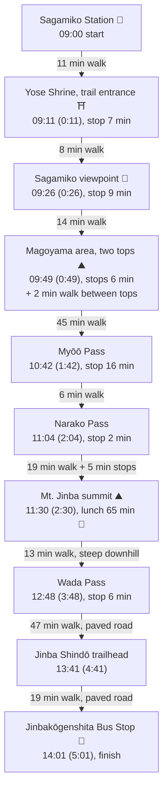

# {{$frontmatter.title}}

{{$frontmatter.description}}

## Getting there 🚂

Start station: [Sagamiko Station][sagamiko-sta] (JR Chuo Line) 🚉

Finish: [Jinbakōgenshita Bus Stop][jinbakogenshita], then a bus to Takao Station 🚏

Travel from Shinjuku to Sagamiko Station: about 1 hr ⏱️

* Take the Keio Line or the JR Chuo Line from Shinjuku to Takao Station. 🚃
* At Takao Station, change to a JR Chuo Line train heading west. Sagamiko Station is the next stop.
* A few JR trains from Shinjuku run through to Sagamiko Station, so you do not need to change.
* [Google Maps route from Shinjuku to Sagamiko Station][map-route-shinjuku]

Bus back from Jinbakōgenshita Bus Stop: 🚌

* Take the `美32` bus to Takao Station North Exit / `高尾駅北口`. The ride takes about 40 min and costs 680 yen, by cash or IC card. 🎟️
* On Sundays, the bus leaves at about 30 minutes past each hour in the afternoon. Check the [bus timetable][bus-timetable] before you go.
* [Google Maps route from the bus stop to Takao Station][map-bus-takao]
* ⚠️ On busy autumn weekends, hikers report long queues at the bus stop. Arrive early, and do not plan on the last bus.

## Trail overview 📋

* Difficulty: Easy - uphill but simple, with soba at the top. 🟢
* Toilets: Use the toilet at Sagamiko Station before you start. The official Tokyo trail map also marks toilets at Myōō Pass, near the summit, at Wada Pass, and at the bus stop. 🚻
* Drink: Carry all the water you need from the start, as I could not confirm a water tap or vending machine on the trail. 🥤
* Lunch: Soba at the summit teahouses, or pack your own. 🍱
* Hiking poles 🔧: 3.5 / 5
  * Good to have for the uphill section.
* Trail running 👟: 2 / 5
  * Quite steep with many roots, so not good for running.
* ⚠️ The last 3.4 km, from Wada Pass to the bus stop, is on a paved road with cars. The Shortcuts section below shows a way to walk less on the road.
* ⚠️ The ridge has many side trails and junctions, so keep a map app open.
* ⚠️ Days are short in autumn and winter. Plan to be at the bus stop by 16:00, and carry a headlamp.

## Trail route 🥾

1. [Sagamiko Station / `相模湖駅`][sagamiko-sta]
2. [Yose Shrine / `與瀬神社`][yose-shrine] and the trail entrance
3. [Sagamiko viewpoint / `相模湖展望台`][sagamiko-viewpoint]
4. [Mt. Magoyama / `孫山`][magoyama]
5. [Myōō Pass / `明王峠`][myoo-pass]
6. [Narako Pass / `奈良子峠`][narako-pass]
7. [Mt. Jinba / `陣馬山`][mt-jinba] summit
8. [Wada Pass / `和田峠`][wada-pass]
9. [Jinba Shindō trailhead / `陣馬新道登山口`][jinba-shindo-trailhead]
10. [Jinbakōgenshita Bus Stop / `陣馬高原下`][jinbakogenshita]

* The route goes from Sagamiko Station over Mt. Jinba and down to Jinbakōgenshita Bus Stop.
* My recorded hikes on YAMAP:
  * [Sagamiko Station to Mt. Jinba via Wada Pass - November 2021 hike][my-yamap-2021] ~5 hr, 10.9 km 🗻
  * [Sagamiko Station to Mt. Jinba via the Jinba Shindō trail - April 2022 hike][my-yamap-2022] ~6 hr, 9.8 km 🗻

Metrics, from my November 2021 hike:

* Duration: 5:01, of which YAMAP counts 3:41 as moving ⏱️
* Distance: 10.9 km 📏
* Elevation gain ↗: 892 m
* Elevation decline ↘: 768 m
* Paved road: about 0.7 km from Sagamiko Station to Yose Shrine, and about 3.4 km from Wada Pass to the bus stop
* Trail type: Point to point (one way)

## Trails on other maps 🗺️

* [YAMAP model course in the opposite direction][yamap-model-course] - starts at Jinbakōgenshita Bus Stop, climbs the Jinba Shindō trail, and ends at Sagamiko Station. YAMAP lists it as 9.4 km, with 717 m up, 843 m down, and a standard time of 4 hr 55 min.
* [Sagamiko Station - Mount Magoyama - Mount Jinba on AllTrails][alltrails]
* [My YAMAP plan from April 2022][yamap-plan] - a group plan for the same route, starting at 10:10. That start is too late for the short days of late autumn and winter, so use the suggested schedule below instead.

## Shortcuts ✂️

### Less road walking on the Jinba Shindō trail

From Wada Pass, the route follows a paved road for about 3.4 km to the bus stop. It took me 1 hr 7 min in November 2021.

To spend less time on the road, go down the Jinba Shindō trail / `陣馬新道` from the summit instead, as I did in April 2022.

* The trail goes down through the forest and joins the road at the Jinba Shindō trailhead, about 1.3 km before the bus stop.
* It skips Wada Pass and its teahouse.
* In April 2022, the walk from the summit to the bus stop took me 1 hr 19 min this way, with a group. In November 2021, the way through Wada Pass took 1 hr 26 min. The pace was different, so treat this as a rough comparison.
* ⚠️ Hikers report that the trail is steep, with many roots, and slippery when wet.

## Timeline ⏱️

The diagram shows my hike on November 7, 2021, from my [YAMAP record][my-yamap-2021]. 🗻

* Arrows show the walking time between two points.
* Boxes show the clock time when I arrived, the time since the start in parentheses, and how long I stopped there.
* YAMAP measured the times, and I rounded them to the minute. A stop is the time YAMAP placed me at that point, so it can include some slow walking.

* Total time: 5 hr 1 min. YAMAP counts 1 hr 20 min of it as rest, including the lunch break.
* I walked faster than the YAMAP standard time of about 5 hr 40 min for the same track, so plan more time for a group.
* Your times will be different. Use these times as estimates, not as a schedule.

## Suggested schedule 📅

This is a suggested plan for Sunday, November 22, 2026, for a group at a relaxed pace. It is not a record of a past hike. I checked the train and bus times on November 16, 2026.

* 07:20 - Leave Shinjuku on a JR `中央特快` (Chuo Special Rapid) train, arriving at Takao Station at 08:04. Or take the 07:09 Keio Line limited express, arriving at Takao Station at 07:59. 🚃
* 08:09 - Leave Takao Station on the JR Chuo Line, arriving at Sagamiko Station at 08:18. 🚉
* 08:25 - Start walking after a toilet stop.
* 11:45 - Reach the summit. This allows 3 hr 20 min with breaks, the time my group took in April 2022. ⛰️
* 11:45 to 12:45 - Lunch at the summit. 🍱
* 13:05 - Pass Wada Pass.
* 14:15 - Reach Jinbakōgenshita Bus Stop. 🚏
* 14:30 - Take the bus, arriving at Takao Station North Exit at about 15:08. The 15:30 bus is the backup. 🚌
* 16:15 - Back in Shinjuku, about 1 hr from Takao Station.

Why this plan starts early:

* Sunset in Tokyo on November 22, 2026 is at 16:31, according to the [National Astronomical Observatory of Japan][naoj-tokyo]. On the route, it is about the same time, but the forest and the valley around the bus stop get dark earlier.
* Leave the summit by 14:00 at the latest. You then reach the bus stop at about 15:30, before dark.
* My older plan left Shinjuku at 08:50 and reached Sagamiko Station at 10:06. With that start, my 2022 group plan reached the bus stop at 16:25, which is after sunset in late November.

Other things to check for this date:

* The famous soba teahouse at the summit listed Sunday, November 22 as open on its [blog][shingen-chaya-blog], but it closes when it rains.
* The hunting season in Kanagawa starts on November 15, so stay on the marked trail.
* As of November 16, 2026, the [Kanagawa trail status page][kanagawa-trail-status] lists closures on nearby trails, but none on this route. Check it again before you go.

## Mountain weather ⛅

* Check the [Mt. Jinba forecast on tenki.jp][tenki-jinba]. Its 3-day forecast is for Hachioji City at the foot of the mountain, labeled `ふもと`, not for the summit.
* The same page also shows the expected temperature and wind at several heights up to 800 m. Use those numbers to judge the summit.

## Food 🍱

* [Shingen Chaya / `信玄茶屋`][shingen-chaya] - the famous soba teahouse at the summit. It posts its open days on its [blog][shingen-chaya-blog] and closes when it rains. 🍵
* [Shimizu Chaya / `清水茶屋`][shimizu-chaya] - another teahouse at the summit that serves soba. 🍵
* [Wada Pass teahouse / `峠の茶屋`][wada-pass-teahouse] - a small teahouse at Wada Pass, below the summit. ☕️

## What to bring 🎒

* [ ] 2 to 3 liters of water 🥤
* [ ] Light snacks 🍙
* [ ] _Optional_ lunch (can buy on the mountain) 🍱
* [ ] Good shoes 🥾
* [ ] Good pants 👖
* [ ] Light T-shirt 👕
* [ ] Light sweater, or a warm jacket in late autumn and winter 🧥
* [ ] Gloves in late autumn and winter 🧤
* [ ] Hiking poles 🔧
* [ ] Towel 🧺
* [ ] Cap 🧢
* [ ] Headlamp, in case you finish after dark 🔦
* [ ] Rain gear ☔
* [ ] IC card or cash for the bus 🎟️

## References 📚

* [Jinbakōgenshita bus timetables on Bus Navi][bus-timetable], for the `美32` bus. 🚌
* [JR Sagamiko Station timetable][jr-sagamiko-timetable], to check that your train stops there. 🚃
* [Jinba and Sagamiko area trail status][kanagawa-trail-status] by Kanagawa Prefecture. 🗾
* [Sunrise and sunset in Tokyo][naoj-tokyo] by the National Astronomical Observatory of Japan.
* [Bear sightings in Hachioji][hachioji-bear-sightings] by Hachioji City.

## All my hikes on this route 🗻

These are all the records on my [YAMAP profile][my-yamap-profile] that start at Sagamiko Station, cross the summit of Mt. Jinba, and end at Jinbakōgenshita Bus Stop. I checked the profile on November 17, 2026.

| Date                                  | Start | Way down               | Time        | Distance | Elevation gain ↗ | Elevation decline ↘ |
| ------------------------------------- | ----- | ---------------------- | ----------- | -------- | ---------------- | ------------------- |
| [November 7, 2021][my-yamap-2021]     | 09:00 | Via Wada Pass          | 5 hr 1 min  | 10.9 km  | 892 m            | 768 m               |
| [April 30, 2022][my-yamap-2022]       | 10:23 | Via Jinba Shindō trail | 6 hr        | 9.8 km   | 850 m            | 724 m               |
| [January 22, 2023][my-yamap-2023-01]  | 10:52 | Via Wada Pass          | 5 hr 31 min | 10.9 km  | 976 m            | 849 m               |
| [June 24, 2023][my-yamap-2023-06]     | 10:29 | Via Jinba Shindō trail | 6 hr 34 min | 10.0 km  | 827 m            | 703 m               |
| [February 24, 2024][my-yamap-2024-02] | 09:44 | Via Wada Pass          | 6 hr 47 min | 11.6 km  | 891 m            | 767 m               |
| [December 1, 2024][my-yamap-2024-12]  | 10:19 | Via Jinba Shindō trail | 6 hr 53 min | 11.7 km  | 846 m            | 766 m               |
| [March 22, 2026][my-yamap-2026-03]    | 10:37 | Via Jinba Shindō trail | 5 hr 38 min | 9.8 km   | 790 m            | 663 m               |

* Time is the total time of the record, including breaks.
* The Shortcuts section above compares the two ways down from the summit.
* The December 2024 record continues for about 35 min past the bus stop and ends about 1.3 km down the road, so its time and distance include that extra stretch.

<!--@include: ../snippets/footer.md-->

<!-- Links -->

[alltrails]: https://www.alltrails.com/trail/japan/tokyo/sagamiko-station-mount-magoyama-mount-jinba
[bus-timetable]: https://transfer.navitime.biz/bus-navi/pc/diagram/BusCourseSearch?busstopId=00042341
[hachioji-bear-sightings]: https://www.city.hachioji.tokyo.jp/kurashi/sangyo/004/jyugai/p034133.html
[jinba-shindo-trailhead]: https://www.google.com/maps/search/?api=1&query=35.65948,139.17833
[jinbakogenshita]: https://goo.gl/maps/UZQvkCwfrMrtgRzD9
[jr-sagamiko-timetable]: https://timetables.jreast.co.jp/timetable/list0730.html
[kanagawa-trail-status]: https://www.pref.kanagawa.jp/docs/f4y/02yama/kouen_kouenhodou/005.html
[magoyama]: https://www.google.com/maps/search/?api=1&query=35.62686,139.18751
[map-bus-takao]: https://maps.app.goo.gl/QgqWZiEAChqi3yT7A
[map-route-shinjuku]: https://goo.gl/maps/wDYrWP4tJHd95dtU6
[mt-jinba]: https://www.google.com/maps/search/?api=1&query=35.65214,139.16653
[my-yamap-2021]: https://yamap.com/activities/14171456
[my-yamap-2022]: https://yamap.com/activities/16966527
[my-yamap-2023-01]: https://yamap.com/activities/22123111
[my-yamap-2023-06]: https://yamap.com/activities/25100598
[my-yamap-2024-02]: https://yamap.com/activities/30033852
[my-yamap-2024-12]: https://yamap.com/activities/36509002
[my-yamap-2026-03]: https://yamap.com/activities/46969409
[my-yamap-profile]: https://yamap.com/users/988731
[myoo-pass]: https://www.google.com/maps/search/?api=1&query=35.64497,139.18420
[naoj-tokyo]: https://eco.mtk.nao.ac.jp/koyomi/dni/2026/s1311.html
[narako-pass]: https://www.google.com/maps/search/?api=1&query=35.64557,139.17907
[sagamiko-sta]: https://goo.gl/maps/yrK7dZ4NSLHZZaKP7
[sagamiko-viewpoint]: https://www.google.com/maps/search/?api=1&query=35.62184,139.18378
[shimizu-chaya]: https://fujino.satrip.jp/shop/shimizuchaya/
[shingen-chaya]: https://goo.gl/maps/dTapUF7J6oNMd3198
[shingen-chaya-blog]: https://shingenchaya.livedoor.blog/
[tenki-jinba]: https://tenki.jp/mountain/normal/3/16/1042.html
[wada-pass]: https://www.google.com/maps/search/?api=1&query=35.65771,139.16858
[wada-pass-teahouse]: https://goo.gl/maps/JyZjdFXxfFcRX1Sv8
[yamap-model-course]: https://yamap.com/model-courses/75600
[yamap-plan]: https://yamap.com/plans/code/zPS6JkPbEN5t7aax37qn5fablUpDV9VoRfo7kKuWccZYqozJKa5RxqQAf-nUiQ2xFp0
[yose-shrine]: https://www.google.com/maps/search/?api=1&query=35.61999,139.18404
