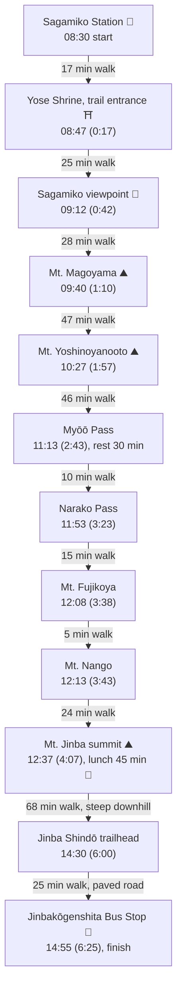

# {{$frontmatter.title}}

{{$frontmatter.description}}

## Getting there 🚂

Start station: [Sagamiko Station][sagamiko-sta] (JR Chuo Line) 🚉

Finish: [Jinbakōgenshita Bus Stop][jinbakogenshita], then a bus to Takao Station 🚏

Travel from Shinjuku to Sagamiko Station: about 1 hr ⏱️

* Take the Keio Line or the JR Chuo Line from Shinjuku to Takao Station. 🚃
* At Takao Station, change to a JR Chuo Line train heading west. Sagamiko Station is the next stop.
* A few JR trains from Shinjuku run through to Sagamiko Station, so you do not need to change.
* The JR fare from Shinjuku to Sagamiko Station is 1,034 yen by IC card. 🎟️
* [Google Maps route from Shinjuku to Sagamiko Station][map-route-shinjuku]

Bus back from Jinbakōgenshita Bus Stop: 🚌

* Take the `美32` bus to Takao Station North Exit / `高尾駅北口`. The ride takes about 40 min and costs 680 yen, by cash or IC card. 🎟️
* On Sundays, the bus leaves at about 30 minutes past each hour in the afternoon. Check the [bus timetable][bus-timetable] before you go.
* [Google Maps route from the bus stop to Takao Station][map-bus-takao]
* ⚠️ On busy autumn weekends, hikers report long queues at the bus stop. Arrive early, and do not plan on the last bus.

## Trail overview 📋

* Difficulty: Easy - uphill but simple, with soba at the top. 🟢
* Toilets: Sagamiko Station, Myōō Pass, near the summit, and the bus stop. 🚻
* Drink: Bring your own. Only the summit teahouses sell drinks. 🥤
* Lunch: Soba at the summit teahouses, or pack your own. 🍱
* Hiking poles 🔧: 3.5 / 5
  * Good to have for the uphill section and the steep way down.
* Trail running 👟: 2 / 5
  * Quite steep with many roots, so not good for running.
* Weather: Check the [Mt. Jinba forecast on tenki.jp][tenki-jinba]. Its 3-day forecast is for the foot of the mountain, labeled `ふもと`, so use the temperature and wind it shows at 800 m to judge the summit. ⛅
* ⚠️ The Jinba Shindō trail down is steep, with many roots, and slippery when wet.
* ⚠️ The last 1.3 km to the bus stop is a paved road with cars.
* ⚠️ The ridge has many junctions, so keep a map app open.
* ⚠️ Days are short in autumn and winter, so carry a headlamp.

## Trail route 🥾

1. [Sagamiko Station / `相模湖駅`][sagamiko-sta]
2. [Yose Shrine / `與瀬神社`][yose-shrine] and the trail entrance
3. [Sagamiko viewpoint / `相模湖展望台`][sagamiko-viewpoint]
4. [Mt. Magoyama / `孫山`][magoyama]
5. [Mt. Yoshinoyanooto / `吉野矢ノ音`][yoshinoyanooto]
6. [Myōō Pass / `明王峠`][myoo-pass]
7. [Narako Pass / `奈良子峠`][narako-pass]
8. [Mt. Fujikoya / `富士小屋山`][fujikoya]
9. [Mt. Nango / `南郷山`][nango]
10. [Mt. Jinba / `陣馬山`][mt-jinba] summit
11. Down the Jinba Shindō trail / `陣馬新道` to the [Jinba Shindō trailhead / `陣馬新道登山口`][jinba-shindo-trailhead]
12. [Jinbakōgenshita Bus Stop / `陣馬高原下`][jinbakogenshita]

* The route goes from Sagamiko Station over Mt. Jinba, down the Jinba Shindō trail, and ends at Jinbakōgenshita Bus Stop.
* This page follows [my YAMAP plan for November 22, 2026][yamap-plan-2026-11].
* I based the plan on [my March 2026 hike on the same route][my-yamap-2026-03], which took 5 hr 38 min and 9.8 km. 🗻

Metrics, from my YAMAP plan:

* Duration: 6 hr 25 min, of which 1 hr 15 min is rest ⏱️
* Distance: 9.5 km 📏
* Elevation gain ↗: 865 m
* Elevation decline ↘: 738 m
* Paved road: about 0.8 km from Sagamiko Station to Yose Shrine, and about 1.3 km from the Jinba Shindō trailhead to the bus stop
* Trail type: Point to point (one way)

### Way down via Wada Pass 🍵

From the summit, you can also go down through [Wada Pass / `和田峠`][wada-pass] instead of the Jinba Shindō trail.

* Wada Pass has a small teahouse 🍵 and a toilet 🚻.
* From Wada Pass, the way follows a paved road with cars for about 3.4 km to the bus stop.
* It is about 30 min faster on the paved road but less fun.

## Trails on other maps 🗺️

* [YAMAP model course in the opposite direction][yamap-model-course] - starts at Jinbakōgenshita Bus Stop, climbs the Jinba Shindō trail, and ends at Sagamiko Station. YAMAP lists it as 9.4 km, with 717 m up, 843 m down, and a standard time of 4 hr 55 min.
* [Sagamiko Station - Mount Magoyama - Mount Jinba on AllTrails][alltrails]
* [My YAMAP plan from April 2022][yamap-plan-2022-04] - a group plan that starts at 10:10 and goes down through Wada Pass. The later start suits the long days of summer.

## Suggested schedule 📅

> [!TIP] In summer, the days are long, so you can start the hike later in the day.

Details: [YAMAP plan][yamap-plan-2026-11].

* 07:20 - Leave Shinjuku on a JR `中央特快` (Chuo Special Rapid) train for Takao, arriving at Takao Station at 08:04. 🚃
* 08:09 - Leave Takao Station on a JR Chuo Line train for Kofu / `甲府`, arriving at Sagamiko Station at 08:18.
  * The next train leaves Takao Station at 08:24 if you miss the transfer. 🚉
* 08:30 - Start walking after a toilet stop.
* 12:37 to 13:22 - Lunch at the summit. 🍱
* 14:55 - Reach Jinbakōgenshita Bus Stop. 🚏
* 15:30 - Take the bus to Takao Station North Exit. The 16:30 bus is the backup, but it leaves at sunset. 🚌
* About 17:15 - Back in Shinjuku, about 1 hr after the bus reaches Takao Station.

The diagram shows the walking part of the plan, point by point.

* Walking time between two points and planned arrival time.

Why this plan starts early:

* The last 5 km is in a narrow valley so it gets really dark.

Other things to check for this date:

* The soba teahouse at the summit closes depending on weather (rains or snow).

## Food 🍱

* [Shingen Chaya / `信玄茶屋`][shingen-chaya] - the famous soba teahouse at the summit. It posts its open days on its [blog][shingen-chaya-blog] and closes when it rains. 🍵
* [Shimizu Chaya / `清水茶屋`][shimizu-chaya] - another teahouse at the summit that serves soba. 🍵
* [Wada Pass teahouse / `峠の茶屋`][wada-pass-teahouse] - a small teahouse at Wada Pass, on the other way down from the summit. 🍵

## What to bring 🎒

* [ ] 2 to 4 liters of water 🥤
* [ ] Cap 🧢
* [ ] Cash for tea house 🎟️
* [ ] Good shoes 🥾
* [ ] Headlamp 🔦
* [ ] Light outer layer
* [ ] Light snacks 🍙
* [ ] Power bank 🔋
* [ ] _Optional_ Hiking poles 🔧
* [ ] _Optional_ Onsen set: underwear, socks, shirt, and towel ♨️
* [ ] _Optional_ Rain gear ☔
* [ ] _Optional_ Sweat towel 🧺
* [ ] _Optional_ lunch (can buy on the mountain) 🍱
* [ ] _Winter_ Gloves 🧤
* [ ] _Winter_ warm jacket 🧥

## References 📚

* [Jinbakōgenshita bus timetables on Bus Navi][bus-timetable], for the `美32` bus. 🚌
* [JR Sagamiko Station timetable][jr-sagamiko-timetable], to check that your train stops there. 🚃
* [Jinba and Sagamiko area trail status][kanagawa-trail-status] by Kanagawa Prefecture. 🗾
* [Sunrise and sunset in Tokyo][naoj-tokyo] by the National Astronomical Observatory of Japan.
* [Bear sightings in Hachioji][hachioji-bear-sightings] by Hachioji City.

## All my hikes on this route 🗻

These are all the records on my [YAMAP profile][my-yamap-profile] that start at Sagamiko Station, cross the summit of Mt. Jinba, and end at Jinbakōgenshita Bus Stop. I checked the profile on November 17, 2026.

| Date                                  | Start | Way down               | Time        | Distance | Elevation gain ↗ | Elevation decline ↘ |
| ------------------------------------- | ----- | ---------------------- | ----------- | -------- | ---------------- | ------------------- |
| [January 22, 2023][my-yamap-2023-01]  | 10:52 | Via Wada Pass          | 5 hr 31 min | 10.9 km  | 976 m            | 849 m               |
| [February 24, 2024][my-yamap-2024-02] | 09:44 | Via Wada Pass          | 6 hr 47 min | 11.6 km  | 891 m            | 767 m               |
| [March 22, 2026][my-yamap-2026-03]    | 10:37 | Via Jinba Shindō trail | 5 hr 38 min | 9.8 km   | 790 m            | 663 m               |
| [April 30, 2022][my-yamap-2022]       | 10:23 | Via Jinba Shindō trail | 6 hr        | 9.8 km   | 850 m            | 724 m               |
| [June 24, 2023][my-yamap-2023-06]     | 10:29 | Via Jinba Shindō trail | 6 hr 34 min | 10.0 km  | 827 m            | 703 m               |
| [November 7, 2021][my-yamap-2021]     | 09:00 | Via Wada Pass          | 5 hr 1 min  | 10.9 km  | 892 m            | 768 m               |
| [December 1, 2024][my-yamap-2024-12]  | 10:19 | Via Jinba Shindō trail | 6 hr 53 min | 11.7 km  | 846 m            | 766 m               |

* Time is the total time of the record, including breaks.
* The [Way down via Wada Pass][way-down-wada-pass] section above compares the two ways down from the summit.
* The December 2024 record continues for about 35 min past the bus stop and ends about 1.3 km down the road, so its time and distance include that extra stretch.

<!--@include: ../snippets/footer.md-->

<!-- Links -->

[alltrails]: https://www.alltrails.com/trail/japan/tokyo/sagamiko-station-mount-magoyama-mount-jinba
[bus-timetable]: https://transfer.navitime.biz/bus-navi/pc/diagram/BusCourseSearch?busstopId=00042341
[fujikoya]: https://www.google.com/maps/search/?api=1&query=35.64963,139.17576
[hachioji-bear-sightings]: https://www.city.hachioji.tokyo.jp/kurashi/sangyo/004/jyugai/p034133.html
[jinba-shindo-trailhead]: https://www.google.com/maps/search/?api=1&query=35.65948,139.17833
[jinbakogenshita]: https://goo.gl/maps/UZQvkCwfrMrtgRzD9
[jr-sagamiko-timetable]: https://timetables.jreast.co.jp/timetable/list0730.html
[kanagawa-trail-status]: https://www.pref.kanagawa.jp/docs/f4y/02yama/kouen_kouenhodou/005.html
[magoyama]: https://www.google.com/maps/search/?api=1&query=35.62686,139.18751
[map-bus-takao]: https://maps.app.goo.gl/QgqWZiEAChqi3yT7A
[map-route-shinjuku]: https://goo.gl/maps/wDYrWP4tJHd95dtU6
[mt-jinba]: https://www.google.com/maps/search/?api=1&query=35.65214,139.16653
[my-yamap-2021]: https://yamap.com/activities/14171456
[my-yamap-2022]: https://yamap.com/activities/16966527
[my-yamap-2023-01]: https://yamap.com/activities/22123111
[my-yamap-2023-06]: https://yamap.com/activities/25100598
[my-yamap-2024-02]: https://yamap.com/activities/30033852
[my-yamap-2024-12]: https://yamap.com/activities/36509002
[my-yamap-2026-03]: https://yamap.com/activities/46969409
[my-yamap-profile]: https://yamap.com/users/988731
[myoo-pass]: https://www.google.com/maps/search/?api=1&query=35.64497,139.18420
[nango]: https://www.google.com/maps/search/?api=1&query=35.65053,139.17387
[naoj-tokyo]: https://eco.mtk.nao.ac.jp/koyomi/dni/2026/s1311.html
[narako-pass]: https://www.google.com/maps/search/?api=1&query=35.64557,139.17907
[sagamiko-sta]: https://goo.gl/maps/yrK7dZ4NSLHZZaKP7
[sagamiko-viewpoint]: https://www.google.com/maps/search/?api=1&query=35.62184,139.18378
[shimizu-chaya]: https://fujino.satrip.jp/shop/shimizuchaya/
[shingen-chaya]: https://goo.gl/maps/dTapUF7J6oNMd3198
[shingen-chaya-blog]: https://shingenchaya.livedoor.blog/
[tenki-jinba]: https://tenki.jp/mountain/normal/3/16/1042.html
[wada-pass]: https://www.google.com/maps/search/?api=1&query=35.65771,139.16858
[wada-pass-teahouse]: https://goo.gl/maps/JyZjdFXxfFcRX1Sv8
[yamap-model-course]: https://yamap.com/model-courses/75600
[yamap-plan-2022-04]: https://yamap.com/plans/code/zPS6JkPbEN5t7aax37qn5fablUpDV9VoRfo7kKuWccZYqozJKa5RxqQAf-nUiQ2xFp0
[yamap-plan-2026-11]: https://yamap.com/plans/code/A9nEjXaJJ4B2gDVOlFCstRh02Aam2j7G34DMORCybbbtZkmnErjkp51hf3mpIzENTFk
[yose-shrine]: https://www.google.com/maps/search/?api=1&query=35.61999,139.18404
[yoshinoyanooto]: https://www.google.com/maps/search/?api=1&query=35.63476,139.17920

<!-- Internal links -->

[way-down-wada-pass]: #way-down-via-wada-pass-
